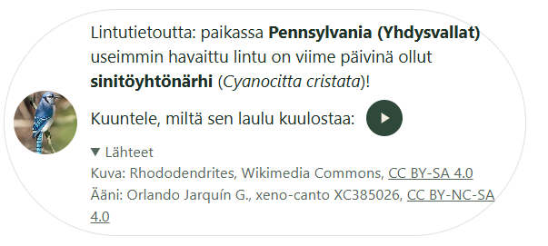
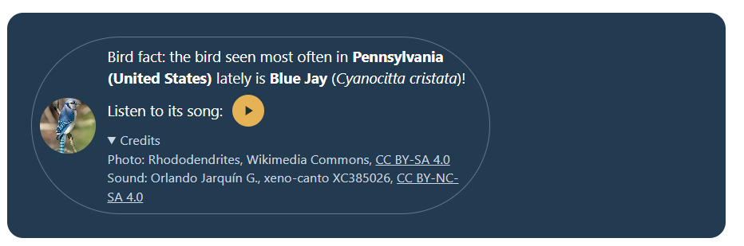

# 🐦 Lintuloota

Lintuloota on pieni verkkosivulle lisättävä boksi, joka kertoo, **mitä lintua kävijän alueella on viime päivinä havaittu useimmin**, näyttää siitä kuvan ja soittaa sen äänen.

<p>
  
  
</p>

*Vasemmalla oletustyylit, oikealla englanninkieliset tekstit ja omat värit. Kuva: Rhododendrites, Wikimedia Commons, [CC BY-SA 4.0](https://creativecommons.org/licenses/by-sa/4.0/).*

Lintulootan teksti voi olla esimerkiksi tällainen:

> Sinun tai VPN:si sijainti on **Helsinki**. Lintu, jota alueellasi on viime päivinä havaittu useimmin, on **talitiainen** (*Parus major*)!
> Kuuntele, miltä sen laulu kuulostaa: ▶

Lintuloota on alun perin tehty sivustolle [esterdufva.fi](https://esterdufva.fi).

> ⚠️ **Lintuloota ei toimi sellaisenaan.** Repossa ei ole avaimia, tietokantaa eikä julkaisua. Tarvitset omat ilmaiset tilit ja avaimet (eBird, xeno-canto, GeoNames, MaxMind) sekä oman Azure Static Web Appin. Avaimet laitetaan **asetuksiin, ei koodiin**: omalla koneella tiedostoon `api/local.settings.json` (ei mene Gitiin) ja Azuressa sovellusasetuksiin. Tämän repon tekijän avaimia tai palvelua ei voi käyttää.

**In English:** Lintuloota ("bird box") is a small, privacy-friendly website widget that shows the bird most often observed near the visitor lately. It infers the visitor's region from their IP address with a local MaxMind GeoLite2 database, counts species on recent eBird checklists, and shows a photo from Wikimedia Commons and a song from xeno-canto – all proxied through Azure Functions, so the visitor's browser never contacts third-party services. Texts, language and colours are configurable. **It does not work out of the box:** you need your own free API keys (eBird, xeno-canto, GeoNames, MaxMind) and your own Azure Static Web App. Keys go into settings, never into code. The documentation is in Finnish; the code is commented in Finnish. MIT licensed.

## Ominaisuudet

- **Sijainti IP-osoitteesta ilman kolmansia osapuolia.** IP-osoite lyhennetään heti (esim. `85.76.12.0`) ja etsitään paikallisesta GeoLite2-tietokannasta. Osoitetta ei tallenneta eikä lähetetä minnekään.
- **Oikea "useimmin havaittu".** Lajit lasketaan eBirdin tuoreista, kattavista havaintolistoista samalla periaatteella kuin eBird itse laskee lajien yleisyyttä.
- **Ei tyhjää boksia.** Neljän vaiheen varajärjestelmä: tuoreet havainnot → vuoden takaiset → alueen lajilistasta arvottu → satunnainen paikka maailmalta.
- **Kuva ja ääni lisensseineen.** Vapaat kuvat Wikimedia Commonsista ja lyhyet äänitteet xeno-cantosta. Tekijät ja lisenssit näkyvät Lähteet-kohdassa.
- **Kaikki kulkee oman palvelimen kautta.** Kävijän selain ei ota yhteyttä eBirdiin, Wikimediaan eikä xeno-cantoon.
- **Asetettavat tekstit, kieli ja värit.** Esimerkiksi englanninkieliset tekstit ja omat brändivärit.
- **Saavutettava.** Ruudunlukijalle nimetty soittonappi, ääni ei käynnisty itsestään, latauksen tila ilmoitetaan.
- **Kevyt.** Selaimen osa on yksi JavaScript- ja yksi CSS-tiedosto ilman riippuvuuksia.

## Pikaohje

Tarvitset: Node.js 22, Azure Functions Core Tools 4, Static Web Apps CLI sekä **omat** ilmaiset avaimet eBirdiin, xeno-cantoon, GeoNamesiin ja MaxMindiin. Tarkat askeleet: **[docs/kayttoonotto.md](docs/kayttoonotto.md)**.

```powershell
git clone https://github.com/MelDv/lintuloota.git
cd lintuloota/api
npm install
copy local.settings.example.json local.settings.json   # täytä omat avaimesi
# lataa GeoLite2-City.mmdb kansioon api/data (ohje: docs/kayttoonotto.md)
cd ..
swa start
```

Avaa http://localhost:4280. Omalla koneella sijaintia ei tunneta, joten näet satunnaisen paikan linnun. Oman alueen lintua voi kokeilla funktiosta suoraan: http://localhost:4280/api/lintu?testi-ip=193.166.3.1

## Lisääminen omalle sivulle

```html
<link rel="stylesheet" href="lintuloota.css">

<div id="lintuloota"></div>

<script src="lintuloota.js"></script>
<script>
    Lintuloota.kaynnista({ elementti: '#lintuloota' });
</script>
```

Sivun ja Azure Functionsin pitää olla samassa osoitteessa, kuten Azure Static Web Appsissa. Tekstit, kieli, värit ja tapahtumat: **[docs/asetukset.md](docs/asetukset.md)**.

## Dokumentaatio

| Ohje | Sisältö |
|---|---|
| [Käyttöönotto](docs/kayttoonotto.md) | avaimet, oma kone, julkaisu Azureen, ongelmatilanteet |
| [Asetukset](docs/asetukset.md) | tekstit ja paikkamerkit, kieli, värit, tapahtumat |
| [Toiminta](docs/toiminta.md) | hakuketju, moduulit, välimuistit, rajapinnat |
| [Tietosuoja](docs/tietosuoja.md) | mitä tietoja käsitellään, valmis teksti tietosuojaselosteeseen |

## Rakenne

```
lintuloota/
├── widget/                      julkaistava sivu
│   ├── lintuloota.js            selaimen osa (tämän ja css:n kopioit omalle sivullesi)
│   ├── lintuloota.css           tyylit ja CSS-muuttujat
│   ├── index.html               esimerkkisivu
│   └── staticwebapp.config.json Azure: Node 22
├── api/                         Azure Functions (Node.js 22)
│   ├── src/functions/           HTTP-funktiot: lintu, lintumedia, lintukuva, lintuaani
│   ├── src/lintu/               moduulit: ip, sijainti, ebird, hakuketju, kuva, aani, välimuisti
│   ├── data/                    GeoLite2-City.mmdb (ladataan itse, ei repossa)
│   └── local.settings.example.json
├── docs/                        ohjeet (kuvat/: README:n kuvakaappaukset)
├── esimerkit/julkaisu.yml       mallijulkaisuputki: kopioi omaan repoosi kansioon .github/workflows/
└── swa-cli.config.json          paikallinen käynnistys: pelkkä "swa start"
```

## Lähteet ja kiitokset

Lintuloota käyttää näitä palveluita ja aineistoja. Kiitos niille! Jokaisella on omat käyttöehtonsa, jotka on hyväksyttävä avainta hakiessa.

- [eBird](https://ebird.org) / Cornell Lab of Ornithology: lintuhavainnot ([API-ehdot](https://www.birds.cornell.edu/home/ebird-api-terms-of-use/))
- [MaxMind GeoLite2](https://www.maxmind.com): sijainti IP-osoitteesta. *This product includes GeoLite2 Data created by MaxMind, available from https://www.maxmind.com.*
- [GeoNames](https://www.geonames.org): paikkojen nimet eri kielillä (CC BY 4.0)
- [Wikimedia Commons](https://commons.wikimedia.org): lintujen kuvat, kunkin kuvan oma lisenssi
- [xeno-canto](https://xeno-canto.org): lintujen äänet, kunkin äänitteen oma lisenssi

## Lisenssi

Lähdekoodi: [MIT](LICENSE) © Ester Dufva. Kuvilla, äänillä ja aineistoilla on omat lisenssinsä (ks. yllä).
